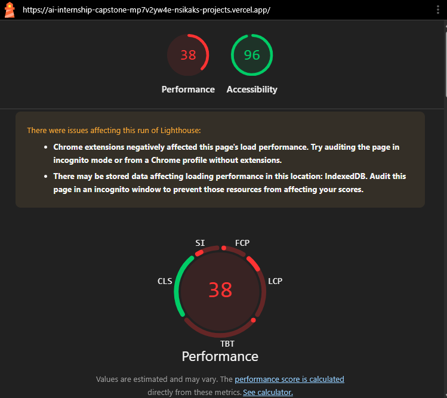
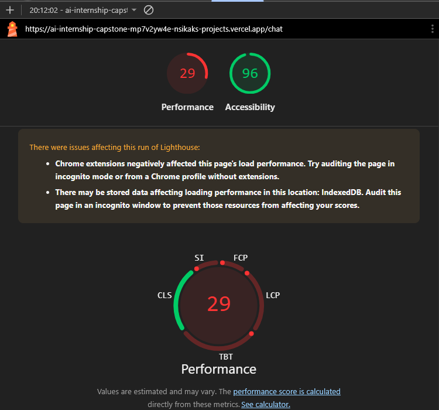
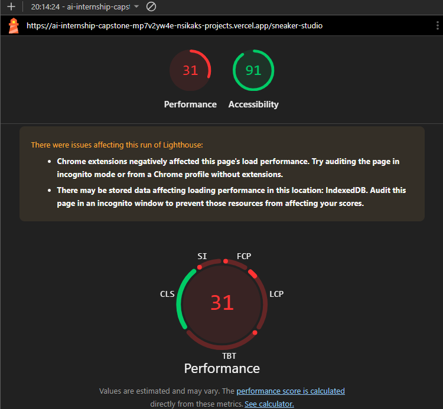

# Week 7 Assignment 2 --- Accessibility and Performance Audit

## Scope

Audited pages: - Homepage (`/`) - Chat (`/chat`) - Sneaker Studio
(`/sneaker-studio`)

Testing included Lighthouse mobile audits, WAVE checks, and a
keyboard-only walkthrough of the primary flows.

## Lighthouse results

### Initial baseline

The initial mobile Lighthouse runs recorded these scores:

  Page               Performance   Accessibility
  ---------------- ------------- ---------------
  Homepage                    33              96
  Chat                        32              96
  Sneaker Studio              32              91

**Baseline testing note:** These initial results may have been affected
by browser extensions. The final measurements were taken in Chrome
Incognito with extensions excluded. Because the test conditions were not
identical, the baseline-to-final differences should be treated as
indicative rather than a perfectly controlled comparison.

### Final results

Final clean Incognito mobile Lighthouse results:

  Page               Performance   Accessibility   Best Practices   SEO
  ---------------- ------------- --------------- ---------------- -----
  Homepage                    94             100              100    60
  Chat                        82             100              100    60
  Sneaker Studio              95             100              100    63

All three pages meet the assignment's minimum targets: Performance 80+
and Accessibility 90+.

### Sneaker Studio optimization

The initial clean Incognito production measurement for Sneaker Studio
was: - Performance: 71 - Accessibility: 95

The 3D preview was then changed to load only after the visitor activates
the **Load interactive 3D preview** button. The static sneaker image is
displayed initially. Once requested, the interactive 3D model loads and
retains rotation and colour customization.

After this change: - Local production build: Performance 96,
Accessibility 100 - Deployed Vercel page: Performance 95, Accessibility
100

The deployed result is the final result reported above.

## WAVE results

  Page               Errors   Contrast errors   Alerts
  ---------------- -------- ----------------- --------
  Homepage                0                 0        0
  Chat                    0                 0        0
  Sneaker Studio          0                 0        0

All three audited pages had zero WAVE errors, zero contrast errors, and
zero alerts in the final checks.

## Changes made

### Chat accessibility

-   Added a descriptive page-level `h1` heading: **AI Chat**.
-   Marked the conversation message container as a polite live log using
    `role="log"` and `aria-live="polite"`.
-   Added `aria-relevant="additions text"`, `aria-atomic="false"`, and
    an accessible label for the conversation.
-   Changed the in-progress action's visible label to **Stop** so its
    purpose is clear.

### Sneaker Studio performance and accessibility

-   Deferred loading the interactive 3D canvas until the visitor
    requests it.
-   Kept a static sneaker image as the initial preview.
-   Preserved the interactive 3D rotation and colour controls after
    loading.
-   Added `aria-pressed` state to the colour selection buttons.

### Other

-   Corrected the Sneaker Studio page component's exported function name
    from `neakerPage` to `SneakerPage`.

## Keyboard-only testing

A keyboard-only walkthrough was completed for the primary flows: -
Navigated between pages using Tab. - Reached and used the Sneaker Studio
controls. - Reached and used the Chat input and Send button. - Reached
and activated the Stop button. - Confirmed visible keyboard focus.

**Screen-reader limitation:** NVDA was not installed, so screen-reader
announcement behaviour was not independently tested. The live-region
attributes were added, but their announcement behaviour should not be
described as verified.

## Evidence screenshots
### Homepage — Baseline Lighthouse results
-   

### Chat — Baseline Lighthouse results
-   

### Sneaker Studio — Baseline Lighthouse results
-   

### Homepage — Final Lighthouse results
-   .png)

### Chat — Final Lighthouse results
-   .png)

### Sneaker Studio — Final Lighthouse results
-   .png)

## Summary

The final clean Incognito mobile Lighthouse results meet the assignment
thresholds on all three pages. WAVE reported zero errors, zero contrast
errors, and zero alerts on all audited pages. The keyboard-only
walkthrough covered the primary page and chat interactions, including
the Stop control. The Sneaker Studio initial load was optimized by
deferring the 3D experience until requested, while retaining its
interactive features.
